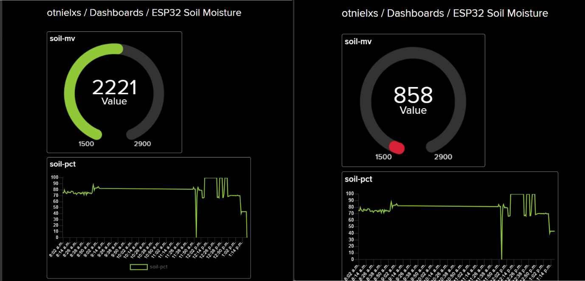
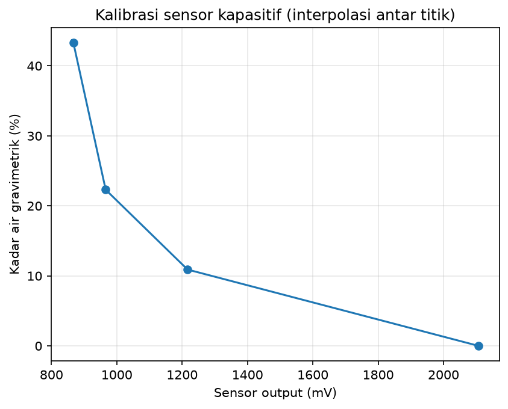
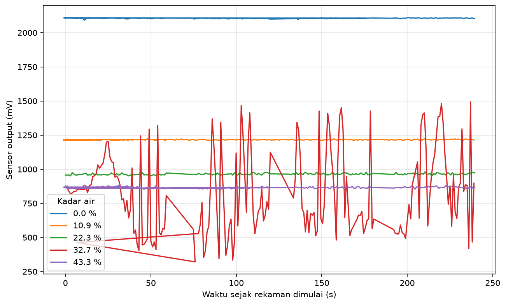
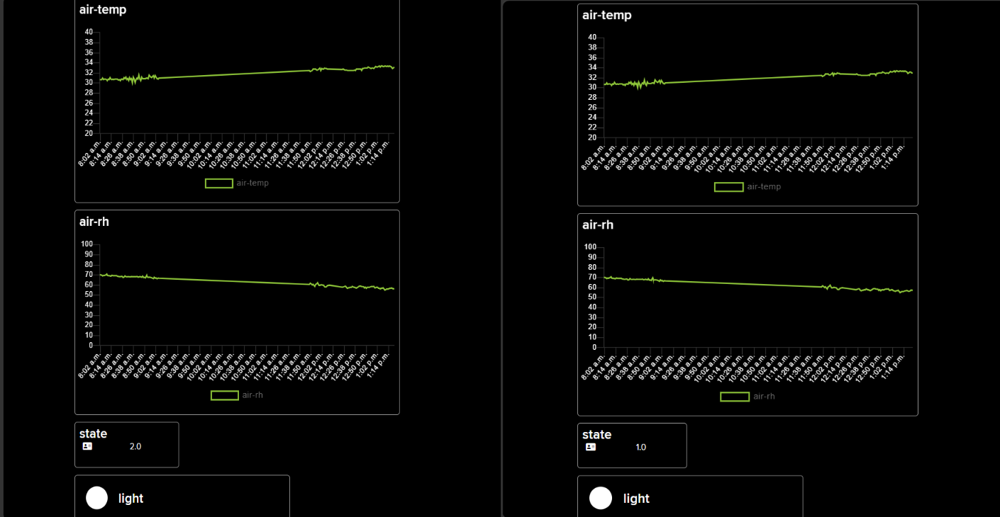

# esp32-soil-moisture-node

An ESP32 soil-moisture monitoring node: a capacitive soil sensor calibrated against gravimetric (weighed) moisture, threshold-based irrigation decision logic with hysteresis, a local OLED display, and a live Adafruit IO dashboard.



## Summary

- **Sensor:** capacitive soil moisture sensor V1.2 on an ESP32 ADC1 pin. Each reading is the median of 15 samples.
- **Calibration:** soil moisture levels prepared by weighing water into air-dried soil, with the sensor logged at each level. Four valid points are used and one is rejected (see [Calibration](#calibration)). Moisture is computed by linear interpolation between the calibration points.
- **Reliable range:** about 0-22 % gravimetric moisture. Between 22 % and 43 % the result is coarse.
- **Decision logic:** an `IDLE -> NEED_WATER -> COOLDOWN` state machine with hysteresis. There is no pump: the node only reports the decision.
- **Telemetry:** soil moisture (mV and %), air temperature, air humidity, light (digital) and state are posted to Adafruit IO every 60 s.

## Hardware

| Part | Role | Connection |
|---|---|---|
| ESP32 DevKit (CP2102) | Microcontroller | USB |
| Capacitive soil moisture sensor V1.2 | Soil moisture (analog) | AOUT -> GPIO34 (ADC1) |
| DHT11 module | Air temperature and humidity | DATA -> GPIO4 |
| LDR module (comparator, digital output) | Light / dark | DO -> GPIO35 |
| SSD1306 OLED 0.96", 128x64, I2C (0x3C) | Local display | SDA -> GPIO21, SCL -> GPIO22 |

All modules are powered from the 3V3 pin. GPIO34 is on ADC1, because ADC2 cannot be used while WiFi is active.


## How it works

- **Reading:** 15 samples 5 ms apart, sorted, median taken (millivolts, 11 dB attenuation). The median rejects single-sample spikes.
- **Conversion:** a lookup table (`CAL_MV`, `CAL_PCT` in `firmware/soil_node/config.h`) with linear interpolation. Readings drier than the first point give 0 %, and readings wetter than the last point are clamped to the last point.
- **Decision logic:** `IDLE` goes to `NEED_WATER` when moisture drops below 10 %, goes to `COOLDOWN` once it rises above 18 %, and returns to `IDLE` after 10 minutes. Two thresholds (hysteresis) stop the state from flickering. The thresholds are design parameters chosen inside the reliable range, not calibration results.
- **Timing:** sensor read every 1 s, DHT11 every 5 s, upload every 60 s, WiFi retry every 30 s. All non-blocking apart from the HTTP posts.
- **Telemetry:** HTTPS POST to the Adafruit IO REST API. Feeds: `soil-mv`, `soil-pct`, `light`, `air-temp`, `air-rh`, `state` (0 = IDLE, 1 = NEED_WATER, 2 = COOLDOWN).
- **Serial output (CSV, 1 Hz):** `ms,soil_mv,soil_pct,temp_c,rh,light_raw,state`

## Calibration

**Method**

1. The soil was air-dried. Dry soil mass was 395 g in a 5 g container (M0 = 400 g).
2. Water was added in steps to the same container and mixed. The container was weighed after each step. Moisture = (M - M0) / 395 g x 100 (gravimetric, relative to the air-dried soil).
3. At each level the sensor was inserted and logged for 240 s at 1 Hz. The mean and standard deviation of the last 60 s are used (the +/- values below are the standard deviation within that window).

| Container + soil (g) | Moisture (%) | Sensor (mV) | Status |
|---|---|---|---|
| 400 | 0.0 | 2107.3 +/- 1.7 | used |
| 443 | 10.9 | 1216.8 +/- 2.7 | used |
| 488 | 22.3 | 966.1 +/- 6.1 | used |
| 529 | 32.7 | not usable | **rejected** |
| 571 | 43.3 | 867.1 +/- 5.5 | used |



**Observations**

- The response is strongly non-linear: roughly 82 mV per % between 0 and 11 %, 22 mV per % between 11 and 22 %, and only about 5 mV per % between 22 and 43 %. A lookup table with interpolation was therefore used instead of a single linear equation.
- The sensor resolves dry-to-moist soil well and loses sensitivity when the soil is wet. This is why the thresholds (10 % and 18 %) sit in the 0-22 % range.

**Rejected point (32.7 %)**

The recording at this level is erratic, with readings jumping between about 320 mV and 1490 mV, and the `ms` counter in the log jumps backwards at several places. It was excluded from the calibration. The cause was not identified; a loose sensor connection is suspected. The raw file is kept in `data/cal_p4_rejected.csv` and the traces of all five recordings are in `docs/cal_traces.png`.



## Demo run

The sensor was left in air for about 10 minutes and then inserted into the 43 % soil for about 10 minutes while the node posted to Adafruit IO. The serial log shows the transition (state 1 = `NEED_WATER` while the sensor is dry in air, state 2 = `COOLDOWN` after moisture rises above 18 %):

```
ms,soil_mv,soil_pct,temp_c,rh,light_raw,state
52000,2217,0.0,33.4,56.4,1,1
53000,1792,3.9,33.4,56.4,1,1
54000,932,29.5,33.4,56.4,1,2
57000,866,43.3,33.4,56.3,1,2
```



## Setup

**Firmware (Arduino IDE)**

1. Install the *esp32 by Espressif* board package and select **ESP32 Dev Module**. On Windows the CP210x USB driver may be needed for the ESP32 to appear as a COM port.
2. Install the libraries: *Adafruit SSD1306*, *Adafruit GFX Library*, *DHT sensor library* and *Adafruit Unified Sensor*.
3. Create the six Adafruit IO feeds listed above (the feed keys must match exactly).
4. Copy `firmware/soil_node/secrets.example.h` to `firmware/soil_node/secrets.h` and fill in your WiFi name and password, Adafruit IO username and key. `secrets.h` is ignored by Git.
5. Open `firmware/soil_node/soil_node.ino` and upload.

**Python (logging and plots)**

```
pip install -r requirements.txt
python analysis/serial_logger.py --port COM7 --out data/log.csv --seconds 60
python analysis/plot_calibration.py
python analysis/inspect_cal.py
```

Close the Arduino Serial Monitor before running the logger, because only one program can hold the serial port.

**Recalibrating:** record each moisture level with `serial_logger.py`, list the files and the weighed moisture in `data/calibration_points.csv`, run `plot_calibration.py`, and copy the resulting mean voltages and moisture values into the `CAL_MV` and `CAL_PCT` arrays in `config.h`.

## Repository layout

```
firmware/soil_node/   soil_node.ino, config.h, secrets.example.h
analysis/             serial_logger.py, plot_calibration.py, inspect_cal.py
tools/hw_test/        hardware test sketch (I2C scan, all sensors, no WiFi)
data/                 calibration recordings and calibration_points.csv
docs/                 figures, screenshots and photos
```

## Limitations

- One soil, one container, one sensor insertion per level. There is no repeatability estimate and no independent validation set.
- The soil was air-dried, not oven-dried, so 0 % is relative to the air-dried state.
- Reliable only for about 0-22 %. Above that, the curve rests on two points and the sensor sensitivity is low. On constant wet soil the displayed value fluctuated between about 40 % and 43 %.
- The calibration is specific to this soil, packing and room temperature (about 33 degrees C during the tests). Temperature dependence was not examined.
- One calibration point (32.7 %) was rejected and not repeated, so the 22-43 % segment is coarse.
- No actuator is connected. Driving a pump safely needs a transistor or relay, a flyback diode and a separate supply, which were not available for this build.
- The DHT11 is a low-accuracy sensor (about +/-2 degrees C and +/-5 % RH). The LDR module gives only a digital bright/dark signal.
- HTTPS requests use `setInsecure()` (the server certificate is not verified), which is acceptable for a hobby project but not for production.
- The HTTP posts can block the main loop for a few seconds if the network is slow.

